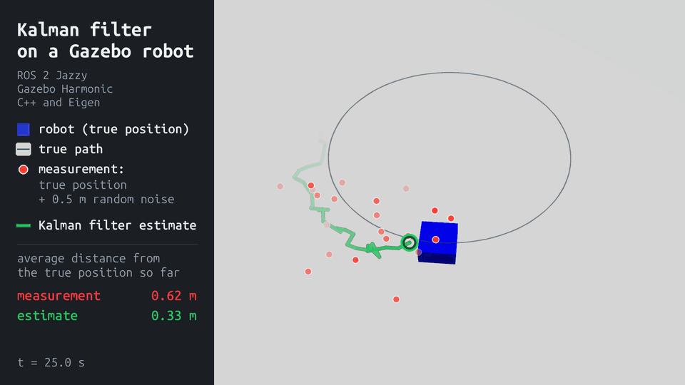

The goal is to write a Kalman filter from scratch to be simulated in ROS2 and Gazebo

Everything will be done in C++ cuz I'm a chad

The box drives a 2 m circle in Gazebo; the gray line is the path it actually drove.
Each red dot is its true position plus random noise (standard deviation 0.5 m), and
the green line is the Kalman filter's estimate. Over this 40 s run the measurements
were 0.62 m from the true position on average and the estimate 0.31 m. The view comes
from a camera added to the world for the recording, with the node's `/measurement`
and `/estimate` topics drawn on top. [Full 40 s video (1080p)](docs/kalman_gazebo.mp4)

## Run it in Gazebo

    source /opt/ros/jazzy/setup.bash
    colcon build
    source install/setup.bash
    ros2 launch launch/kalman_filter_gazebo_launch.xml

Gazebo opens with a blue box driving a 2 m circle. Every 0.1 s the terminal
prints the box's true position, a noisy measurement of it (true position plus
random noise with a standard deviation of 0.5 m), and the Kalman filter's estimate.

To plot them, run `ros2 run rqt_plot rqt_plot` and add these in its Topic box:

    /model/robot/odometry/pose/pose/position/x
    /measurement/x
    /estimate/x

To drive the box yourself (quitting teleop stops the box):

    ros2 run teleop_twist_keyboard teleop_twist_keyboard --ros-args -r cmd_vel:=/model/robot/cmd_vel
